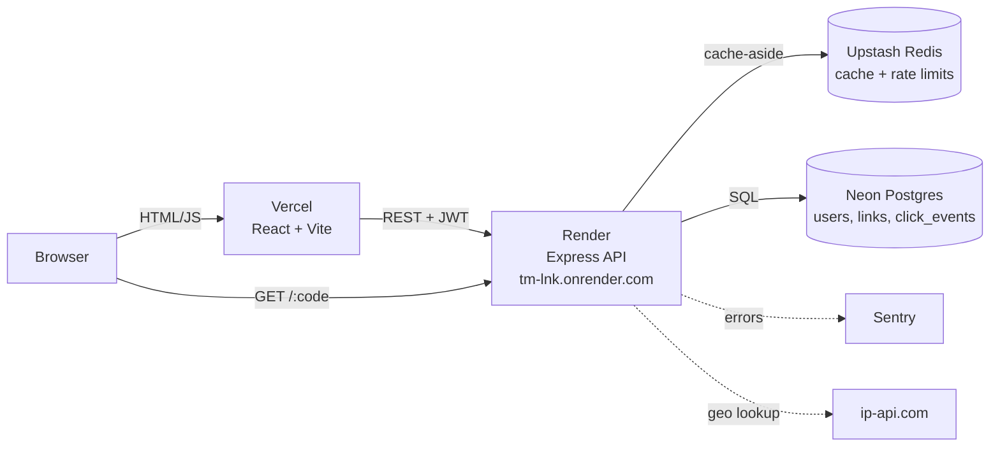
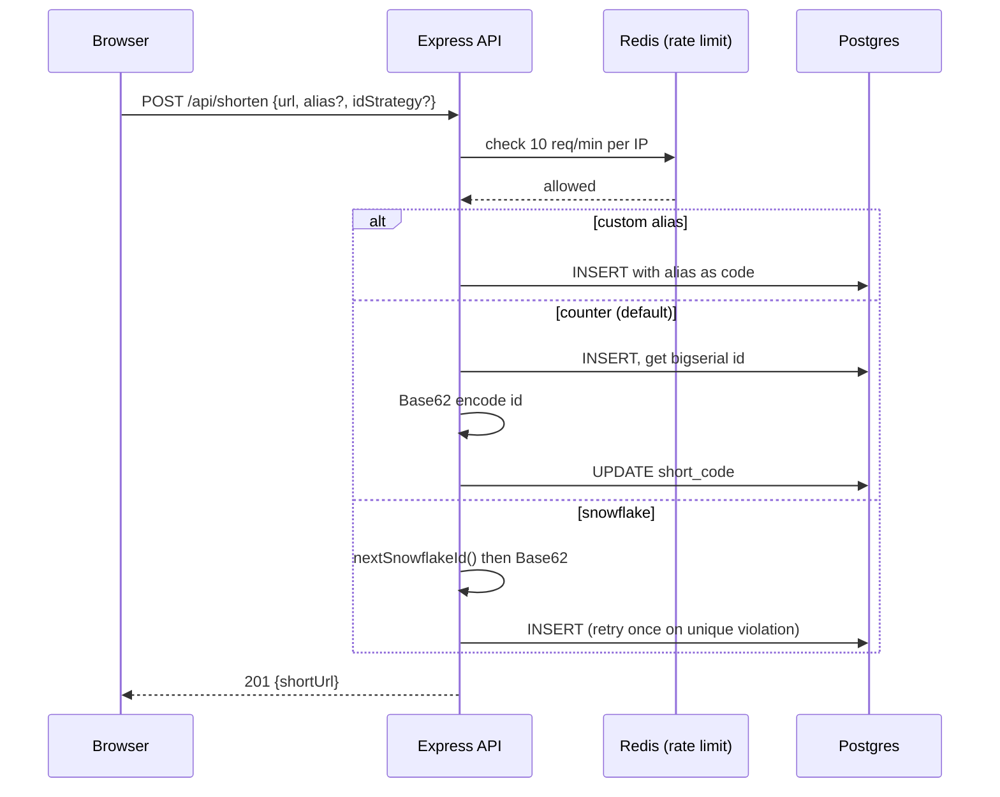
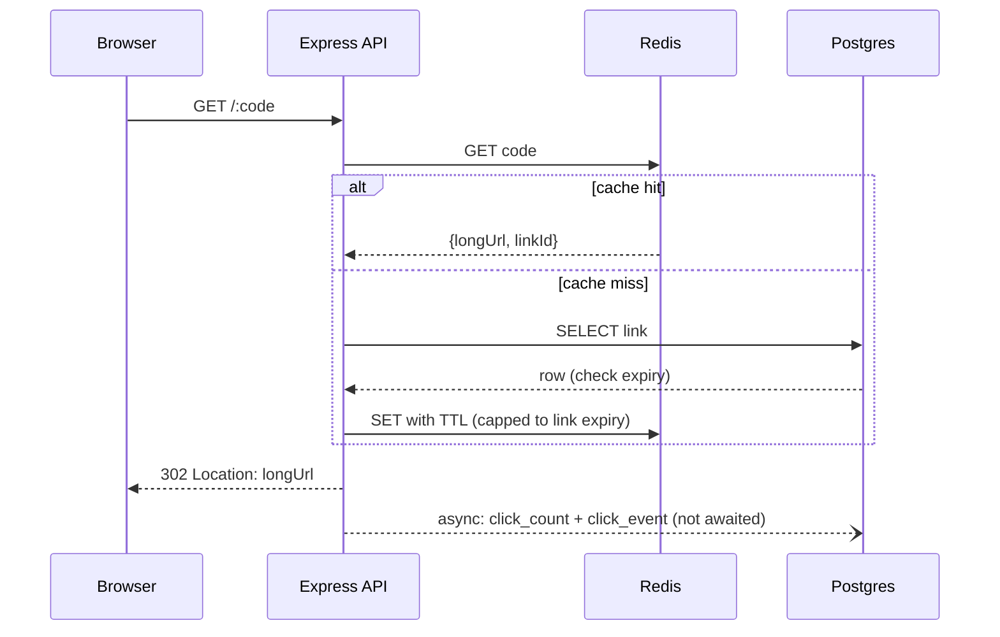
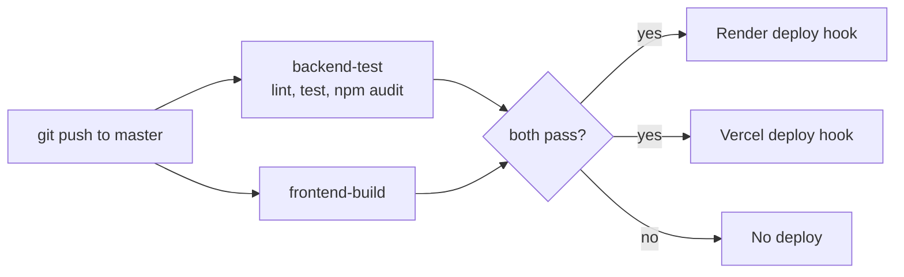

# trim.link

[](https://github.com/OmegaZeroG/URL-Shortner/actions/workflows/ci-cd.yml)

**Live**: https://trim-link-forge.vercel.app (frontend) · https://tm-lnk.onrender.com (API)

A portfolio project demonstrating system-design fundamentals: URL shortening with Base62 encoding, Redis caching, rate limiting, JWT auth, and click analytics.

See [`../DESIGN.md`](../DESIGN.md) for the full system design doc (requirements, capacity estimation, API contract, DB schema, encoding strategy, architecture) and [`../PROGRESS.md`](../PROGRESS.md) for build progress.

## Architecture



### Shorten flow (`POST /api/shorten`)



### Redirect flow (`GET /:code`)



### CI/CD



## Stack
- Backend: Node.js + Express + PostgreSQL (Neon)
- Frontend: React (Vite) + Tailwind CSS
- Cache: Redis (Upstash)
- Deploy: Render (backend) + Vercel (frontend), gated by GitHub Actions CI/CD

## Project structure
```
URL-Shortner/
├── backend/     Express API
└── frontend/    React UI
```

## Local setup

### 1. Database (Neon)
1. Create a free project at [neon.tech](https://neon.tech).
2. Copy the connection string from the Neon dashboard (includes `?sslmode=require`).
3. Paste it into `backend/.env` as `DATABASE_URL` (see step 2 below), then run:
```
cd backend
npm run migrate
```
This applies every file in `migrations/` against whatever `DATABASE_URL` points to. Re-running it is always safe (all statements are `IF NOT EXISTS`).

(Local Postgres also works — see `.env.example` for the local connection string format.)

### 2. Backend
```
cd backend
cp .env.example .env   # paste your Neon DATABASE_URL
npm install
npm run migrate         # applies the DB schema — do this once (or after adding new migrations)
npm run dev
```
API runs on `http://localhost:4000`.

### 3. Frontend
```
cd frontend
cp .env.example .env   # points at the backend URL
npm install
npm run dev
```
UI runs on `http://localhost:5173`.

## Deployment (Render + Vercel, gated by CI)

Auto-deploy-on-push is **disabled** on both platforms on purpose. Deploys only happen after `.github/workflows/ci-cd.yml`'s `backend-test` and `frontend-build` jobs pass on a push to `master`, via each platform's Deploy Hook. This means broken code never reaches production.

### Backend → Render
1. [render.com](https://render.com) → New → Web Service → connect the `URL-Shortner` GitHub repo.
2. Root Directory: `backend`. Build Command: `npm install`. Start Command: `npm start`.
3. Environment variables: `DATABASE_URL` (Neon, pooled connection), `REDIS_URL` (Upstash), `JWT_SECRET` (generate with `node -e "console.log(require('crypto').randomBytes(32).toString('hex'))"` — use a different value than your local `.env`), `FRONTEND_ORIGIN` (your Vercel URL, e.g. `https://trim-link-forge.vercel.app` — without it CORS blocks the frontend), `BASE_URL` (this service's public URL, used to build the short links), optional `SENTRY_DSN` and `SNOWFLAKE_WORKER_ID` (0-1023, unique per instance). Don't set `PORT` — Render injects it automatically and the app already reads `process.env.PORT`.
4. Settings → Build & Deploy → **Auto-Deploy: No**.
5. Settings → Deploy Hook → copy the URL.
6. Note your service's public URL (`https://<your-service-name>.onrender.com`) — you'll need it for the frontend. Render subdomains can't be renamed later, so pick a short service name up front (this project uses `tm-lnk`).
7. Express runs with `trust proxy` set to `2` because Render sits behind two proxy hops (Cloudflare + Render's load balancer). Change it if you deploy elsewhere.
8. Uptime monitors should ping `/health` (static, no DB). `/health/db` queries Postgres and is for manual checks only — pinging it keeps Neon awake and burns the free compute allowance.

### Frontend → Vercel
1. [vercel.com](https://vercel.com) → New Project → import the same GitHub repo.
2. Root Directory: `frontend`. Framework Preset: Vite (auto-detected).
3. Environment variables (add as plain env vars, not secrets): `VITE_API_BASE_URL` = your Render backend URL from above (`https://tm-lnk.onrender.com`), and optionally `VITE_SENTRY_DSN` (use a separate Sentry project from the backend). Redeploy after changing them — Vite bakes them in at build time.
4. `frontend/vercel.json` already sets `git.deploymentEnabled: false`, so Vercel won't auto-deploy on push — only the Deploy Hook will trigger it.
5. Settings → Git → Deploy Hooks → create one, copy the URL.

### Wire up GitHub Actions
In the GitHub repo → Settings → Secrets and variables → Actions, add:
- `RENDER_DEPLOY_HOOK` = the Render deploy hook URL
- `VERCEL_DEPLOY_HOOK` = the Vercel deploy hook URL

Push to `master` and the `deploy` job in the Actions tab will fire once tests pass.

## Load Test Results

Benchmarked with [k6](https://k6.io) against a local instance (still using the real production Neon + Upstash over the network, nothing mocked) — see `backend/loadtest/` for the scripts and methodology. Compares the redirect path (`GET /:code`) on a guaranteed Redis cache miss (falls through to Postgres) vs. a guaranteed cache hit (served entirely from Redis).

| Scenario | Requests | p50 | p90 | p95 | max |
|---|---|---|---|---|---|
| Cache **miss** (Postgres) | 200 (20 VUs) | 301.6ms | 381.9ms | 580.7ms | 1.64s |
| Cache **hit** (Redis) | 6,351 (20 VUs, 30s) | 93.6ms | 96.0ms | 98.0ms | 261.5ms |

**The Redis cache-aside layer cuts redirect latency by ~3.2x at p50 and ~5.9x at p95**, with the gap widening at the tail — the cache-miss path has much higher variance (Postgres connection + query overhead), while the cache-hit path stays consistently fast under sustained concurrent load (0% errors across all 6,351 requests). This is the concrete evidence behind the caching decision in `DESIGN.md` section 8, not just a design assumption.

## Lighthouse (measured)
| | Performance | Accessibility | Best Practices | SEO |
|---|---|---|---|---|
| Desktop | 99 | 100 | 100 | 90* |
| Mobile (slow 4G) | 90 | 100 | 100 | 90* |

\*Measured before adding the meta description, which was the missing item. Re-run to confirm. Mobile FCP/LCP was 2.9s before the font-weight trimming (12 → 7 font files).

## Performance work
- Analytics endpoint: 5 DB round trips cut to 2 (`UNION ALL` with a `dim` tag column), plus a composite index on `click_events(link_id, clicked_at)` (`migrations/002_analytics_composite_index.sql`).
- Gzip via `compression` middleware.
- Frontend code-splitting (`React.lazy`) for login, My Links and Analytics screens.
- Benchmarks for the analytics query and endpoint: `scripts/benchmark-analytics-index.sql` and `loadtest/analytics-test.js` (results not recorded yet).

## Current status: Phase 2 + CI/CD
- [x] `POST /api/shorten` — Base62-encoded short codes + custom alias support
- [x] `GET /:code` — 302 redirect, async click_count increment, expiry check
- [x] Redis (Upstash) caching in front of redirect lookups — cache-aside pattern, see `src/utils/cache.js`
- [x] CI/CD: GitHub Actions lints + tests on every push/PR, deploys to Render + Vercel only on a passing push to `master`
- [x] Rate limiting — 10 requests/min per IP on `POST /api/shorten`, Redis-backed (`src/middleware/rateLimiter.js`)
- [x] JWT auth + per-user link management — signup/login, bcrypt password hashing, Bearer token stored in localStorage, "My Links" dashboard (list + delete, owner-only), anonymous shortening still works
- [x] Analytics dashboard — click events logged async per redirect (device/browser via `ua-parser-js`, country via `ip-api.com`, referrer), charted per-link in the frontend (clicks over time + device/browser/country/referrer breakdown, via hand-rolled charts — see `Charts.jsx`)
- [x] Security hardening — `helmet`, CORS origin allowlist (`FRONTEND_ORIGIN`), Redis-backed rate limiting on login/signup, Dependabot + `npm audit --audit-level=high` gating CI
- [x] Snowflake-style distributed ID generator — opt-in alternative to counter+Base62 (`src/utils/snowflake.js`), selectable via a dropdown in the shorten form, see `system-design-one-pager.md` section 4b
- [x] Sentry error tracking — backend (`@sentry/node`) and frontend (`@sentry/react`), both DSN-gated and no-op without your own Sentry account/keys (see `PROGRESS.md`)
- [x] UI redesign — Tailwind CSS v4 "Ink & Ember" theme (dark slate + amber accent, Space Grotesk/DM Sans/JetBrains Mono), hand-rolled charts instead of Recharts, `lucide-react` icons
- [x] Renamed to trim.link; moved to a new Render service (`tm-lnk`) and a new Neon database after the old one hit the free compute limit (caused by a DB-touching keep-alive endpoint, now fixed)
- [x] `trust proxy` fixed for Render's two proxy hops (real client IPs for rate limiting and geo lookups)

